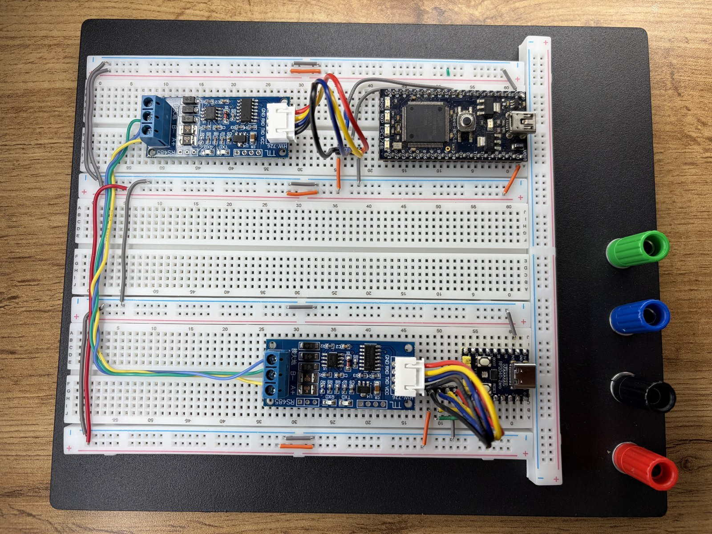
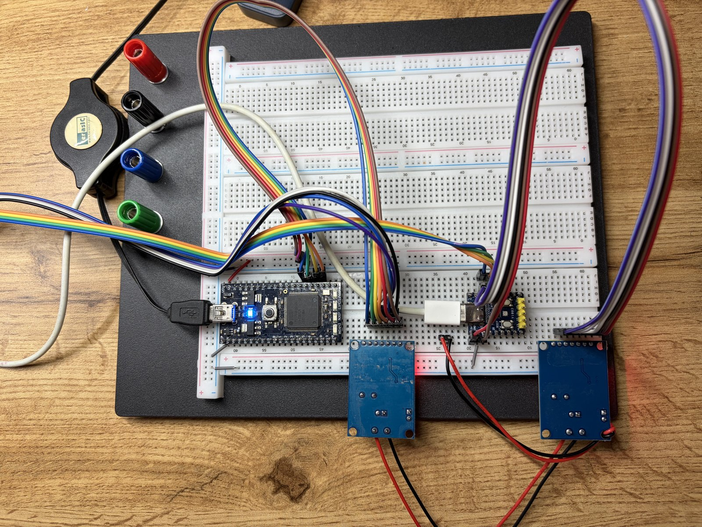
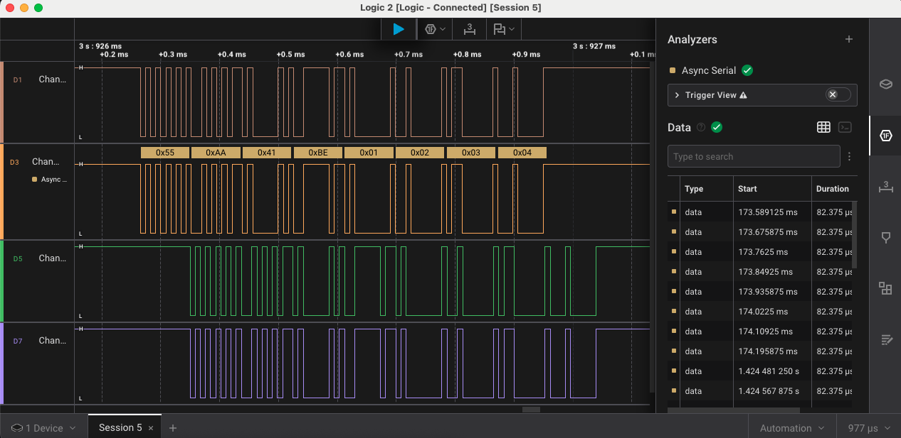
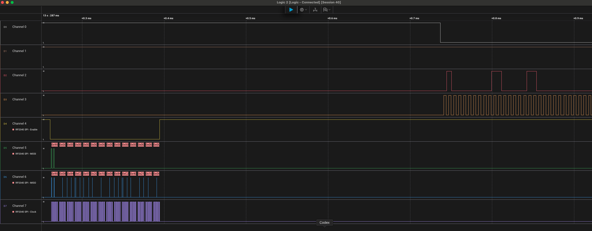
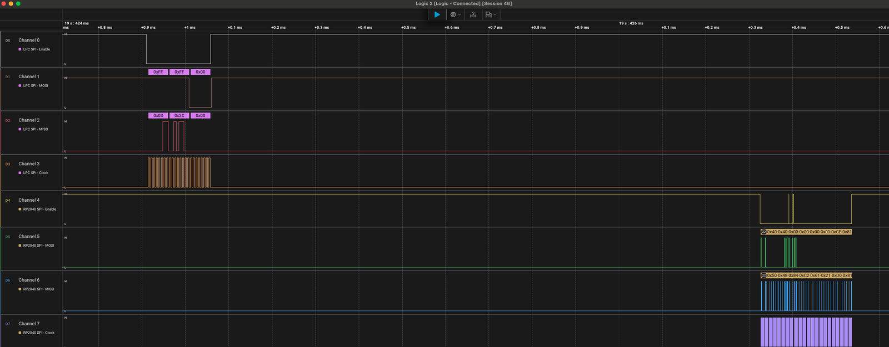
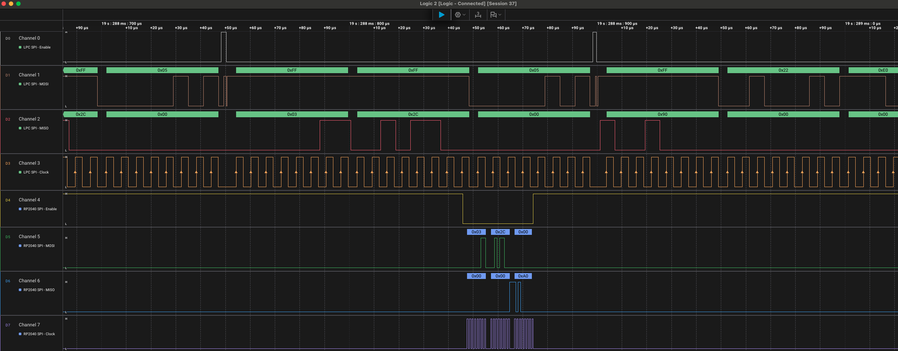
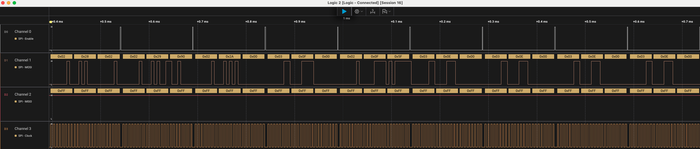
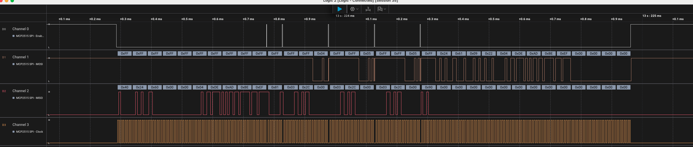

# Logic-Analyzer Captures & HIL Evidence

Signal-level proof that the RS-485 and CAN stacks run on **real two-node hardware**,
not in simulation. All captures were taken with a Saleae logic analyzer against the
benches shown below. MCP2515 SPI is decoded using the chip's command set
(`0x02` write, `0x03` read, `0x40/0x41` load TX buffer, `0x90` read RX buffer,
`0x81` RTS) and register map (`0x28`–`0x2A` = CNF3/CNF2/CNF1 bit-timing,
`0x2C` = CANINTF).

> The exact byte values in the captions below were read from the analyzer;
> cross-check them against the annotated `.sal` sessions if you reuse them elsewhere.

---

## The Benches

### RS-485 HIL

LPC1768 (mbed) and an RP2040-Zero, each sitting behind an HW-726 TTL↔RS-485
transceiver module (`A+ / B- / GND` screw terminals). The green/blue/yellow wires
join the two `A+`/`B-` pairs into a single two-wire differential bus — the physical
link behind the 115385-baud capture below.

### CAN HIL

LPC1768 and RP2040-Zero, each driving its own MCP2515 controller (with a TJA1050
transceiver) over bit-banged SPI (the ribbon cables). The red/black leads carry the
shared CANH/CANL bus and 5 V rail. This is the real 125 kbps bus — no internal
loopback, no simulated peer.

---

## RS-485

### DATA frame decoded on the wire

The Async Serial analyzer decoding a full DATA frame across the probed lines:
`0x55 0xAA` sync bytes followed by the COBS-framed payload. Measured line rate
115385 baud (+0.16 % of the 115200 nominal). Confirms the framing seen on the bus
matches what the encoder produces, and that the DE (driver-enable) half-duplex
arbitration hands the line over cleanly between DATA and ACK.

---

## CAN (MCP2515, 125 kbps, One-Shot Mode)

### Reception confirmed at the register level (READ RXB0)

The receiving node issues `0x90` (READ RX BUFFER, starting at RXB0) and MISO returns
the received CAN frame — identifier followed by the data payload. This is the core
proof of bidirectional traffic: a frame put on the bus by one node is read back out
of the other node's receive buffer. Verified in both directions across independent
15 s captures.

### Both nodes on the bus simultaneously

Eight channels captured at once: LPC1768 SPI on D0–D3 and RP2040 SPI on D4–D7, each
talking to its own MCP2515 while sharing the CANH/CANL bus. Shows the two
independent SPI masters interleaving on a live bus.

### Clean SPI timing after the bit-bang rewrite

A zoomed transaction with clock edges annotated. The bit-banged SPI HAL replaced the
Pico SDK's `hardware_spi` peripheral after that peripheral was shown to corrupt data
on rapid back-to-back short transfers; this capture is the clean-timing result.

---

## Debugging the Physical Bus: Four Stacked Faults

Getting the two-node bus to actually pass a frame took isolating **four independent
hardware faults**, any one of which alone would have killed the link. They had to be
found one at a time because each masked the next.

1. **Bad transceiver.** One TJA1050 was dead on arrival — no recessive/dominant
   transition on CANH/CANL even with correct SPI traffic reaching the MCP2515.
2. **Swapped SPI SI/SO.** MOSI and MISO were crossed on one node, so configuration
   writes went out but nothing meaningful ever came back on the read path.
3. **Swapped CANH/CANL.** The differential pair was reversed between the two
   transceivers, so the nodes could never agree on bus state.
4. **Termination routed in series.** A module connector placed the 120 Ω
   termination resistor *in series* with the bus instead of *across* CANH/CANL,
   collapsing the differential signal.

### Evidence

**Early bring-up — read path dead:**

Bit-timing configuration writes (`0x02` to CNF1/2/3, registers `0x28`–`0x2A`). MISO
sits idle-high throughout — the symptom that pointed at the crossed SI/SO pair,
since the writes clearly leave the master but nothing is ever clocked back.

**After the fixes — data integrity end-to-end:**

Known test payload `0xDE 0xAD 0xBE 0xEF` written into the TX buffer on MOSI and read
back intact on MISO. A recognizable vector surviving the full write→bus→read path is
the clearest single-frame proof that all four faults are resolved.

---

## Files

| File                             | Session | What it shows |
| -------------------------------- | ------- | ------------- |
| `img/rs485_bench.jpg`            | —       | RS-485 two-node physical bench |
| `img/can_bench.jpg`              | —       | CAN two-node physical bench |
| `img/rs485_frame_decode.png`     | 5       | RS-485 DATA frame, async-serial decode |
| `img/can_rxb0_decode.png`        | 40      | READ RXB0 — received CAN frame |
| `img/can_both_nodes_spi.png`     | 46      | Both nodes' SPI captured together |
| `img/spi_clock_edges.png`        | 37      | Zoomed SPI with clock edges |
| `img/can_deadbeef_roundtrip.png` | 35      | 0xDEADBEEF written and read back |
| `img/mcp2515_bittiming_config.png` | 16    | CNF1/2/3 config writes, pre-fix read path |
