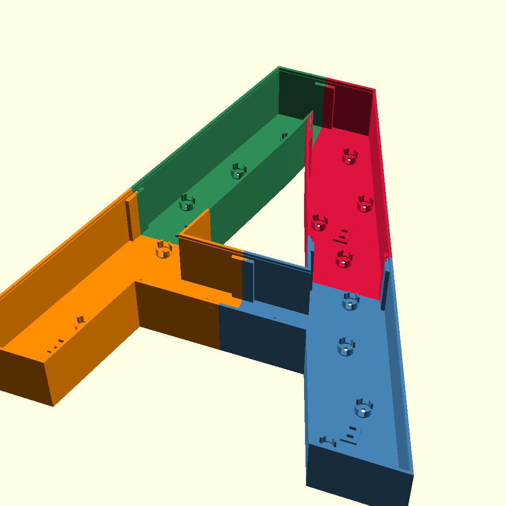

# Letras LED modulares para eventos

Generador **automático** de letras corpóreas retroiluminadas (15 cm – 1 m de
alto) impresas en 3D, que **se paran solas** sobre el piso o una mesa, con
píxeles **WS2812B** y un único controlador **ESP32-S3** con un cable a cada
letra.

Escribes la palabra y la altura; un solo comando produce todo lo necesario
para fabricarla y armarla:

```
python3 cad/generate.py --text "HOLA" --letter-height 400 --output-dir build/HOLA
```

| Sale del generador | Para qué |
|---|---|
| `*_carcaza.stl`, `*_diffusor.stl` | Carcaza opaca + difusor translúcido de cada pieza de la letra |
| `*_base_*.stl` | Segmentos de la base con la forma de la letra |
| **`manual_ensamble.html` / `.pdf`** | **Manual de ensamble del letrero**: materiales, impresión, pasos por letra con diagramas, notas especiales, conexionado y montaje en el lugar |
| `assembly_<letra>.svg` | Mapa de píxeles de cada letra |
| `manifest.json`, `bom.csv` | Datos completos del plan (piezas, píxeles, fuentes, cables, estabilidad) |
| `firmware/main/letters_config.h` | Mapa físico de cada LED, salida y límite de corriente por letra (se actualiza solo) |

**Cero tornillos y cero pegamento.** Cada pieza sale con su código grabado
(`H r0c1`, `H B0a`) y el manual usa esos mismos códigos.



## Cómo funciona

```
 texto + altura ──► generate.py ──► OpenSCAD (2D) ──► plan en Python:
                                                        · grilla de piezas que entran en la cama
                                                        · cortes lejos de los bordes de la letra
                                                        · píxeles + orden de la tira + extensiones
                                                        · base: tamaño por ángulo de vuelco, segmentos, colas de milano
                                                        · puerto de conexión, códigos grabados
                                                        · fuente y salida del controlador por letra
                        ┌────────────────────────────────┘
                        ▼
               OpenSCAD (3D, en paralelo) ──► STL
                        │
                        ├──► manual_ensamble.html/.pdf (con notas especiales automáticas)
                        ├──► manifest.json / bom.csv / assembly_*.svg
                        └──► firmware/main/letters_config.h ──► ESP32-S3 (ESP-IDF)
```

### Decisiones de diseño

- **OpenSCAD headless** (en vez de Blender/FreeCAD): 100 % paramétrico y
  ejecutable por línea de comandos. Python hace la parte "inteligente" (dónde
  cortar, dónde va cada LED, qué tan grande es la base) y le pasa coordenadas a
  OpenSCAD.
- **Letra = grilla de piezas** que entran en la cama de la impresora, unidas
  por una **lengüeta continua con cordón** que sigue la pared de la letra:
  encastra con un clic y se imprime sin soportes.
- **Base autoportante**: la letra baja dentro de un hueco con la forma de su
  propia parte inferior (sostiene O, S, V…), y la base se dimensiona para un
  ángulo de vuelco mínimo (15° por defecto) a partir del centro de gravedad
  real de la letra. Se divide en segmentos que se unen con colas de milano
  verticales. Si las bases de dos letras vecinas se superpondrían, el generador
  separa las letras.
- **Una fuente de 5 V por letra y un cable de datos por letra**: las letras
  quedan independientes (se pueden separar y reordenar) y un solo ESP32-S3
  maneja hasta 16 letras en paralelo usando su periférico LCD con DMA.
- **Píxeles WS2812B de 12 mm en tira-cable** encajados en zócalos impresos,
  con separación ≈ profundidad (difusión pareja). El firmware conoce la
  posición física de cada LED.

## Tamaños de referencia

"HOLA", Liberation Sans Bold, píxeles con 100 mm de cable entre LEDs, ángulo
de vuelco mínimo 15°.

| Altura | Cama | Piezas de letra | Segmentos de base | Piezas impresas | Píxeles | Extensiones | Base (prof. × alto) | Fuentes |
|---|---|---|---|---|---|---|---|---|
| 150 mm | 220 | 4 | 4 | 12 | 33 | 1 | 81×20 mm | 2 A |
| 250 mm | 220 | 14 | 8 | 36 | 64 | 3 | 85×20 mm | 2 A |
| 400 mm | 220 | 15 | 10 | 40 | 83 | 4 | 118×25 mm | 2 A |
| 600 mm | 220 | 29 | 14 | 72 | 157 | 7 | 166×38 mm | 2/3 A |
| 600 mm | 350 | 15 | 8 | 38 | 155 | 6 | 166×38 mm | 2 A |
| 1000 mm | 220 | 76 | 38 | 190 | 437 | 9 | 274×58 mm | 4–8 A |
| 1000 mm | 350 | 29 | 14 | 72 | 407 | 9 | 274×58 mm | 4–6 A |

Para letras de 60 cm – 1 m conviene una impresora de cama grande (≥ 350 mm):
**reduce las piezas a menos de la mitad**.

## Inicio rápido

Requisitos: `openscad` (2021.01+), Python 3.10+ (sin dependencias externas).
Opcional: Chromium o Chrome para exportar el manual a PDF.

```bash
cd cad

# 1. Calibrar la unión una vez por impresora/material (docs/fabricacion.md)
openscad -o cupon.stl -D 'part="snap_test_coupon"' -D joint_clearance=0.18 part.scad

# 2. Ver el plan y el manual sin generar STL (segundos)
python3 generate.py --text "HOLA" --letter-height 600 --bed-x 256 --bed-y 256 \
    --plan-only --output-dir ../build/HOLA

# 3. Generar todo
python3 generate.py --text "HOLA" --letter-height 600 --bed-x 256 --bed-y 256 \
    --joint-clearance 0.18 --jobs 8 --output-dir ../build/HOLA
```

Después: imprimir → seguir `build/HOLA/manual_ensamble.pdf` → compilar y
grabar el [firmware](firmware/README.md).

Opciones principales de `generate.py` (`--help` para todas):

| Opción | Por defecto | |
|---|---|---|
| `--letter-height` | — | Altura total de la letra en mm (150–1000) |
| `--depth` | 16 % de la altura, 40–150 mm | Profundidad de la caja |
| `--bed-x/--bed-y/--bed-z` | 220/220/250 | Volumen de impresión |
| `--tip-angle` | 15 | Ángulo de vuelco mínimo de cada letra sobre su base (°) |
| `--no-stand` | — | Sin base (letras colgadas o pegadas a una pared) |
| `--led-pitch` | ≈ profundidad (máx. cable/1.4) | Separación entre píxeles |
| `--pixel-lead` | 100 | Largo de cable entre píxeles de la tira que compres |
| `--joint-clearance` | 0.18 | Holgura de la unión, del cupón de calibración |
| `--font` | `Liberation Sans:style=Bold` | Cualquier fuente instalada (`fc-list`) |
| `--chrome` | autodetectado | Binario de Chromium/Chrome para el PDF del manual |
| `--no-manual` | — | No generar el manual |

## El manual de ensamble

Se genera en cada corrida con los datos exactos de esa corrida:

- Portada con la vista frontal del letrero, salidas del controlador y totales.
- Materiales: cada STL con su cantidad y filamento aproximado; electrónica
  con la fuente de cada letra y el largo de cada cable.
- Por letra: orden de encastre de las piezas, mapa de píxeles con extensiones,
  ubicación del puerto de conexión, vista superior y lateral de la base con los
  ángulos de vuelco, y tabla de piezas.
- **Notas especiales automáticas**, sólo cuando aplican: extensiones de cable
  (con largo y ubicación), piezas con partes unidas por nervaduras, piezas
  angostas, cortes cerca de bordes, apoyo angosto, letras altas que conviene
  lastrar, inyección de alimentación en letras con muchos píxeles, uniones de
  base sin cola de milano, trazos demasiado finos para el puerto.
- Conexionado del controlador (salida → GPIO → letra), montaje en el lugar con
  lista de verificación, prueba (`letters`, `chain_test`) y desmontaje.

## Estructura

```
letras-led-modulares/
├── cad/
│   ├── generate.py          # orquestador: plan de letras, STL, manifiesto, firmware, manual
│   ├── geom.py              # geometría 2D (contornos de OpenSCAD, polígonos, cortes)
│   ├── base_plan.py         # base: estabilidad, segmentos, colas de milano
│   ├── features.py          # puerto de conexión y códigos grabados
│   ├── manual.py            # manual de ensamble HTML/PDF con diagramas SVG
│   ├── part.scad            # entrada CLI de OpenSCAD (una pieza por llamada)
│   ├── channel_letter.scad  # carcaza, difusor, zócalos, amarres, puerto, nervaduras
│   ├── base.scad            # segmento de base con hueco y colas de milano
│   └── lib/snap_fit.scad    # uniones a presión + cupón de calibración
├── firmware/                # proyecto ESP-IDF para ESP32-S3
│   ├── main/                # main, effects, power, lanes, output (bus LCD), web, settings
│   └── test/                # tests en host (efectos, limitador, codificador paralelo)
└── docs/                    # fabricación, electrónica, ensamble
```

## Validación hecha

- "HOLA" a 400 mm (40 STL) y "AT" a 1 m (94 STL, con bases de varios
  segmentos, puertos, códigos y nervaduras): verificadas automáticamente,
  **cada pieza de una sola parte y con malla cerrada**. Las únicas piezas en
  varias partes son difusores de zonas separadas de la letra (el manual lo
  indica).
- Sección de la unión verificada (lengüeta/cordón vs. boca/cámara):
  
- Firmware: compila sin warnings con ESP-IDF 5.4.1 para ESP32-S3; tests en
  host de efectos, limitador de corriente y codificador de salidas paralelas
  con AddressSanitizer/UBSan (`make -C firmware/test`).

## Limitaciones conocidas

- **Nada fue probado todavía con hardware real.** Antes de un evento: imprimir
  el cupón de calibración, una letra chica completa con su base, y verificar
  la salida paralela del ESP32-S3 con una letra (idealmente con un analizador
  lógico).
- La salida paralela de 16 líneas (9–16 letras) no está probada; con hasta 8
  letras se usa el bus de 8 líneas.
- Las letras con ramas (A, E, H, K…) necesitan alguna extensión de cable en la
  tira de píxeles; el manual indica dónde y de qué largo.
- Las letras de 1 m son pesadas y altas: lastrar la base si hay público cerca
  o viento (el manual lo marca como nota especial).
