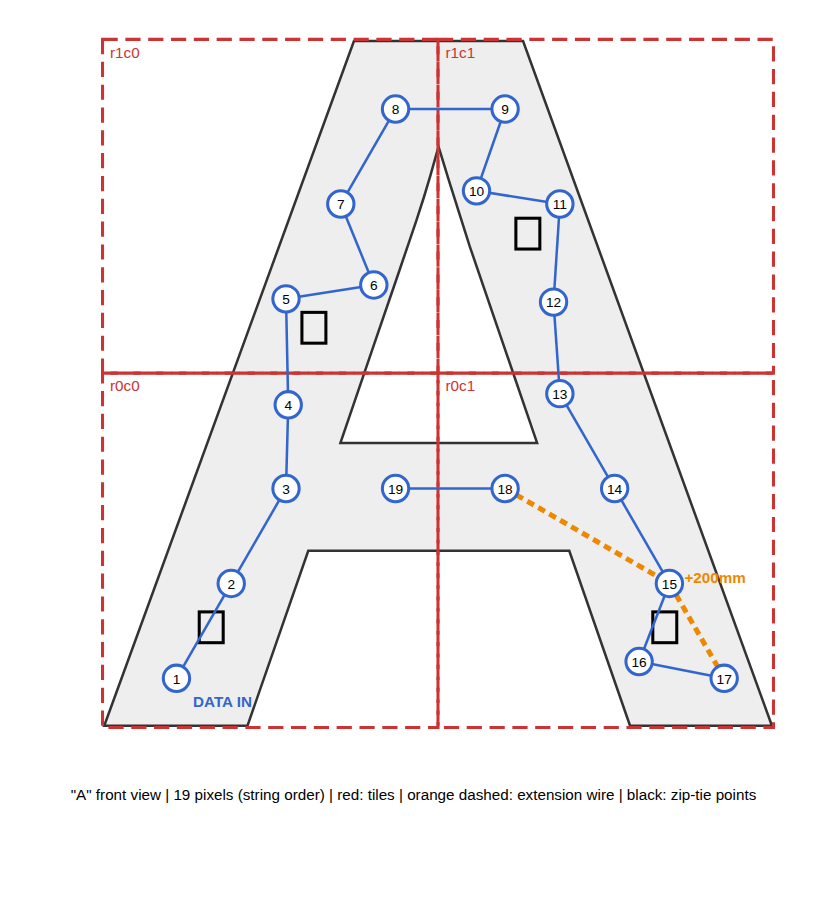

# Ensamble

**El manual de ensamble de cada letrero se genera automáticamente**
(`manual_ensamble.html` / `.pdf` en la carpeta de salida de `generate.py`),
con los códigos de pieza, el orden de encastre, el mapa de píxeles, la base,
el conexionado y las notas especiales de esa corrida. Este documento resume
el proceso general.

## Resumen por letra

1. **Encastrar las piezas** boca abajo sobre una mesa: primero cada fila de
   izquierda a derecha (la lengüeta del borde derecho entra en la ranura de la
   pieza siguiente), después las filas de abajo hacia arriba. Presionar a lo
   largo de la costura hasta el clic. Cada pieza tiene su código grabado en el
   dorso (`H r0c1` = letra H, fila 0 desde abajo, columna 1 desde la izquierda).
2. **Colocar los píxeles** con la letra boca arriba: empujar cada uno en su
   zócalo siguiendo la numeración del mapa, desde el `1`. Donde el mapa marca
   una extensión en naranja, intercalar el cable del largo indicado.
3. **Cablear el puerto** (una vez): jack DC y GX12 al píxel 1 (ver
   [electronica.md](electronica.md)).
4. **Probar** con el efecto `chain_test` antes de cerrar.
5. **Cerrar con los difusores**: cada uno lleva el mismo código que su
   carcaza; presionar el borde hasta el clic.
6. **Armar la base** (si tiene segmentos): apoyar el segmento de atrás a la
   izquierda y deslizar los demás desde arriba sobre las colas de milano. Cada
   segmento tiene su código grabado en la cara inferior (`H B0a`).
7. **Bajar la letra dentro del hueco de la base** hasta que apoye en el fondo.
   Queda trabada por su propia forma; se retira levantándola.

## Notas especiales

El manual agrega notas sólo cuando corresponden, por ejemplo: extensiones de
cable, piezas con partes unidas por nervaduras (no cortarlas), piezas
angostas, letras altas que conviene lastrar, letras con muchos píxeles que
necesitan inyección de alimentación, o uniones de base sin cola de milano.

## Transporte

Las letras se transportan **armadas** (la tira de píxeles atraviesa las
costuras) y separadas de sus bases. Las piezas sólo se separan para reparar:
soltar el difusor, sacar los píxeles de esa pieza (empujándolos desde atrás
por el agujero de servicio) y hacer palanca en la costura.

## Montaje alternativo sin base

Con `--no-stand` no se genera la base. Las letras se pueden colgar de un truss
con precintos por los puntos de amarre (dos ranuras en el dorso) o fijar a una
pared con Dual-Lock / VHB.
